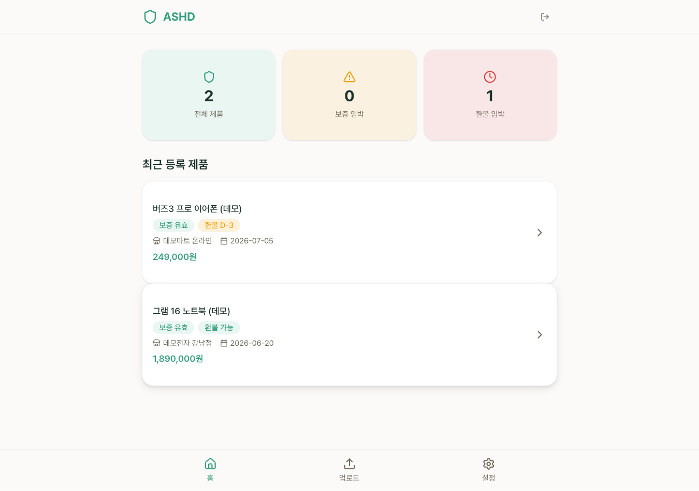
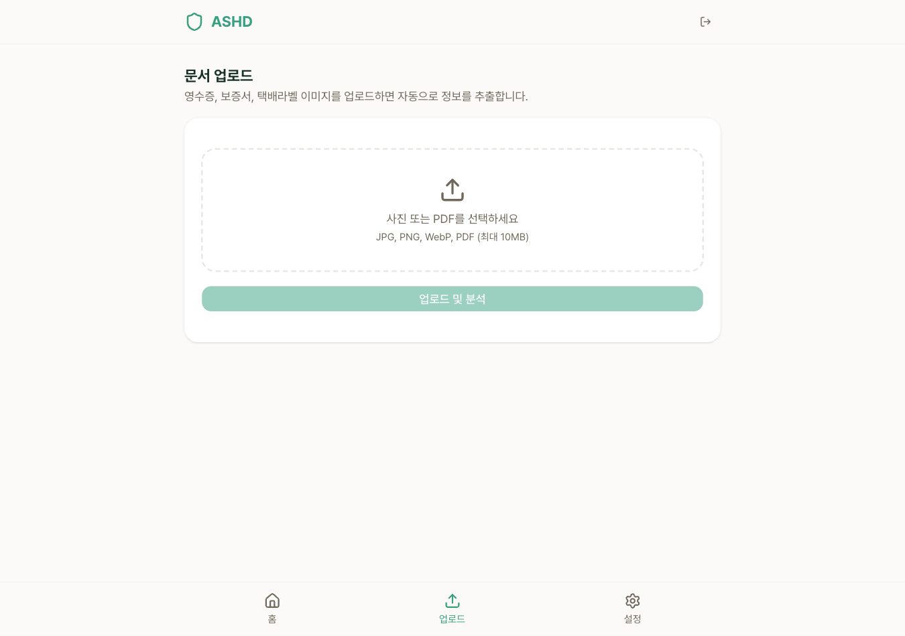
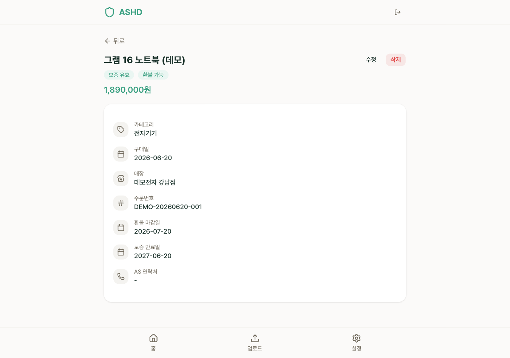

# ASHD — 한국어 영수증 OCR+LLM 추출 파이프라인 (eval 회귀 게이트로 운영)

영수증/보증서 이미지를 업로드하면 OCR(Google Vision) + 룰 추출기 + LLM 보완 추출로 상호명·구매일·금액을 자동 파싱하고, 환불/보증 기한이 임박하면 이메일/텔레그램으로 알려주는 웹 서비스입니다. 추출 정확도는 `pnpm eval`로 수치화하고 CI에서 회귀를 막는 방식(eval-driven)으로 운영했습니다.

**프로젝트 성격:** 라이브로 배포해 직접 써 본 서비스입니다. 가입 계정은 몇 개 수준이었고, 결제는 웹훅 로그만 남기고 과금하지 않았습니다. 이후 성장을 멈추고 포트폴리오 자산으로 전환했습니다. 아래 "왜 접었나" 섹션에 그 판단을 정리했습니다.

## 라이브 데모

**https://ashd.bkan.dev**

| 대시보드 | 업로드 + 처리 상태 | 제품 상세/기한 |
|---|---|---|
|  |  |  |

캡처일: 2026-07-12. 데모가 다운되어 있으면 위 스크린샷을 참고해 주세요.

> 이 공개 스냅샷은 기준일 2026-07-12의 전시용 사본이며, 라이브 서비스는 원본(private) 레포에서 계속 배포됩니다.

## Eval — 추출 정확도를 수치로 관리

`extractFieldsWithRules`(룰 추출기, `src/lib/extractors/rule.ts`)의 필드별 정확도를 SROIE식 Precision/Recall/F1로 측정하는 회귀-가드입니다. 스펙은 [`eval/SDD.md`](eval/SDD.md), 실행/구조/정직성 노트는 **[`eval/README.md`](eval/README.md)**(1차 근거)에 있습니다.

### 실측 기록 (2026-07-05, KORIE OCR Test 스플릿 314예제)

| 필드 | 개선 전 F1 | 개선 후 F1 |
|---|---|---|
| store | 9% (브랜드 목록 방식) | 100% (첫줄 휴리스틱) |
| purchase_date | 89% | 99% |
| amount | 98% | 100% |

시드 골드셋(10건, `eval/gold/receipts.jsonl`)은 3필드 모두 F1 100%(`eval/baseline.json`)를 CI 회귀 기준점으로 고정하고 있습니다.

측정 의미론 정직 노트: KORIE 데이터는 필드별 크롭 전사라 원문 영수증 텍스트가 없고, `store`/`amount` 지표는 위치·라벨 발견이 아니라 각각 "수용 동작"과 "값 파싱" 능력을 재는 것에 가깝습니다. 자세한 조건은 `eval/README.md`의 "측정 의미론(정직 노트)"를 참고하세요.

CI 회귀 게이트: `.github/workflows/eval.yml`이 PR/push마다 `pnpm eval -- --check`를 실행해 시드셋 F1이 `baseline.json`보다 하락하면 실패시킵니다. KORIE 벤치마크는 데이터가 레포 밖(연구용 라이선스)이라 기록용이며 게이트 대상은 아닙니다.

## 아키텍처

### 기술 스택

| 영역 | 기술 |
|------|------|
| Framework | Next.js 15 (App Router) |
| Language | TypeScript (strict) |
| BaaS | Supabase (Auth, DB) |
| File Storage | Cloudflare R2 (S3 호환) |
| Styling | Tailwind CSS 4 |
| OCR | Google Vision API |
| LLM | OpenAI / Anthropic (dual provider) |
| Email | Resend |
| Messaging | Telegram Bot API |
| Deploy | Vercel (Hobby, icn1/Seoul) |
| Package Manager | pnpm 10+ |

### 아키텍처 결정 사항 (v2 현행)

| 결정 | 선택 | 이유 |
|------|------|------|
| Auth | Supabase Auth + no-arg `getClaims()` 게이팅 | 로컬 ES256 검증으로 네트워크 왕복 없음; 인가-중요 경로(presign/문서 처리)는 `getUser()` 유지 |
| 파일 업로드 | 클라이언트 → R2 presigned URL 직접 업로드 + 서버 사이드 재검증 | Vercel body limit 우회, presign은 크기를 강제하지 않아 업로드 후 서버가 실제 객체를 재확인 |
| 문서 처리 | API Route + `after()`로 응답 이후 비동기 처리 | Hobby 응답 시간 제약 대응, 클라이언트는 즉시 job 상태 수신 |
| LLM 프로바이더 | 듀얼(OpenAI/Anthropic), `LLM_PROVIDER` env로 전환 | 벤더 락인 회피 |
| 알림 dedup | `alert_log` 유니크 upsert(`ignoreDuplicates`) 기반 | (제품, 종류, 임계일, 채널) 조합당 정확히 1회 발송 |
| Cron | Vercel Cron(매일 1회) | Hobby 플랜은 daily cron만 허용 |
| RLS | `(SELECT auth.uid())` 패턴 | 행마다 재평가되지 않도록 성능 최적화 |
| 결제(Polar) | 웹훅 수신 후 로그만 기록, DB write 없음 | 유료화 실험 흔적 — 현재 비활성·미과금 |

## 왜 접었나

기능은 완성됐지만 시장 신호는 명확히 "정지"였습니다. 직접 경쟁 앱이 같은 기능(영수증 기한 관리)을 전기능 무료로 제공하고 있었고(아차.com), 카드사/은행 알림톡·토스 등 결제 인프라 레벨에서도 유사 알림이 이미 무상 제공되고 있었습니다. 네이버 영수증, 카카오페이 같은 대형 플랫폼이 영수증 저장/조회 기능을 자체 서비스에 번들링하면서 독립 앱의 존재 이유가 더 줄었습니다. 유료화는 결제 연동(Polar 웹훅) 실험 단계까지만 진행하고 과금을 활성화하지 않은 채 중단했는데, 이 카테고리의 B2C 지불 의사가 무료 경쟁 구도상 성립하기 어렵다고 판단했기 때문입니다. 업로드 1건마다 OCR+LLM 비용이 발생하는 구조상 무료로 유지할수록 유닛 이코노믹스가 역방향으로 움직이는 점도 컸습니다. 기술적 실패가 아니라 시장 판단에 따라 성장을 중단했고, 완성도 있는 코드베이스를 포트폴리오 자산으로 전환했습니다.

## 하드닝 서사

프로덕션 운영 과정에서 다음을 정리·강화했습니다.

- **Silent failure 제거**: cron/webhook 인증은 시크릿 미설정 시 "인증 없음"이 아니라 fail-closed로 500을 반환하도록 했고, 백그라운드 처리 실패는 로거로 구조화 기록됩니다.
- **LLM 출력 검증**: LLM 응답은 `parseJsonSafely`로 안전 파싱 후 `sanitizeExtractedFields`(텍스트 길이 상한, 날짜 정규화, 금액 상한 10억원)로 도메인 밖 값을 걸러냅니다.
- **알림 dedup + catch-up**: `alert_log` 테이블에 (제품, 종류, 임계일, 채널) 유니크 upsert로 중복 발송을 막고, 미발송 임계값은 다음 실행에서 자동으로 따라잡습니다.
- **Open-redirect 방어**: OAuth 콜백의 `next` 파라미터는 `resolveSafeNext`로 same-origin 상대 경로만 허용합니다.
- **HTML 이스케이핑**: 이메일 알림 본문에 들어가는 사용자 데이터(제품명, 이메일)는 `escapeHtml`로 이스케이프합니다.
- **RLS 성능 최적화**: 모든 테이블 RLS 정책이 `(SELECT auth.uid())` 패턴을 사용해 행별 재평가를 방지합니다.
- **일일 처리 쿼터**: 사용자당 하루 처리 작업 수를 제한해 비용 폭주를 막습니다(아래 S5 참고).

개발 커밋 이력은 private 원본 레포에 있으며 요청 시 공유합니다.

## 운영비 0 유지 장치

| 장치 | 내용 | 근거 |
|---|---|---|
| Vercel Hobby / icn1 | 무료 플랜, 함수 리전을 서울(icn1)로 고정해 지연 최소화 | `vercel.json`(`regions: ["icn1"]`) |
| 일일 처리 쿼터 | 사용자당 하루 30건(`DAILY_JOB_QUOTA`) 초과 시 429 응답 | `src/lib/job-policies.ts`, `src/app/api/documents/process/route.ts` |
| 업로드 용량 서버 검증 | presigned URL은 크기를 강제하지 않으므로, 처리 직전 서버가 객체를 재조회해 10MB/허용 형식을 벗어나면 400으로 거부 | `src/app/api/documents/process/route.ts` |
| OCR 타임아웃 설정값 | `.env.example`에 `OCR_TIMEOUT_SECONDS=15`가 정의되어 있으나, 실측 결과 v2의 OCR 호출(`src/lib/ocr.ts`)에는 아직 타임아웃(AbortController 등)으로 연결되어 있지 않음 — v1에서 이관된 미배선 설정값 |
| Daily cron keep-alive | 매일 1회(`0 0 * * *`) 실행되는 cron이 매번 Supabase에 쿼리를 보내 Free tier의 7일 무활동 일시정지를 예방하는 효과가 있음(단, Supabase 정책 변경 시 보장되지 않음) | `vercel.json`(cron 스케줄), `src/app/api/cron/daily-alerts/route.ts`(매 실행마다 stalled job reaper + 알림 쿼리로 Supabase 접촉) |
| 발신 도메인 | `RESEND_FROM=ASHD <noreply@ashd.app>` — DKIM(`resend._domainkey`)·SPF(`send` 서브도메인)·MX·DMARC DNS 레코드 구성 완료 (2026-07-13 dig 실측) | `.env.example`, `ashd.app` DNS |

## 빠른 시작

```bash
pnpm install
cp .env.example .env.local   # Supabase/OCR/LLM/Resend/Telegram 키 입력
pnpm dev
```

## 프로젝트 구조

```
src/
├── app/
│   ├── (auth)/              # 로그인/회원가입
│   ├── (dashboard)/         # 대시보드, 제품 CRUD, 업로드, 설정
│   └── api/
│       ├── cron/daily-alerts/  # Vercel Cron: 기한 알림 + stalled job reaper
│       └── documents/process/  # OCR + LLM 파이프라인
├── components/              # 공유 UI 컴포넌트
├── lib/
│   ├── extractors/          # Rule/LLM 추출기 + 검증
│   ├── notifications/       # Email/Telegram/Formatter
│   └── r2/                  # Cloudflare R2 presign/업로드
└── types/database.ts        # Supabase 타입
eval/                        # 추출 정확도 회귀 게이트 (F1 측정)
```

## 품질 검사

```bash
pnpm type-check   # TypeScript 타입 검사
pnpm build        # 프로덕션 빌드
pnpm lint         # ESLint
pnpm eval -- --check   # 추출기 F1 회귀 게이트
```

## v1 참조

v1(Python/FastAPI) 프로토타입 문서는 이 공개 스냅샷에서 제외되었습니다(현행 v2와 스택이 달라 혼선 방지 목적). 필요 시 원본(private) 레포에서 확인 가능합니다.
